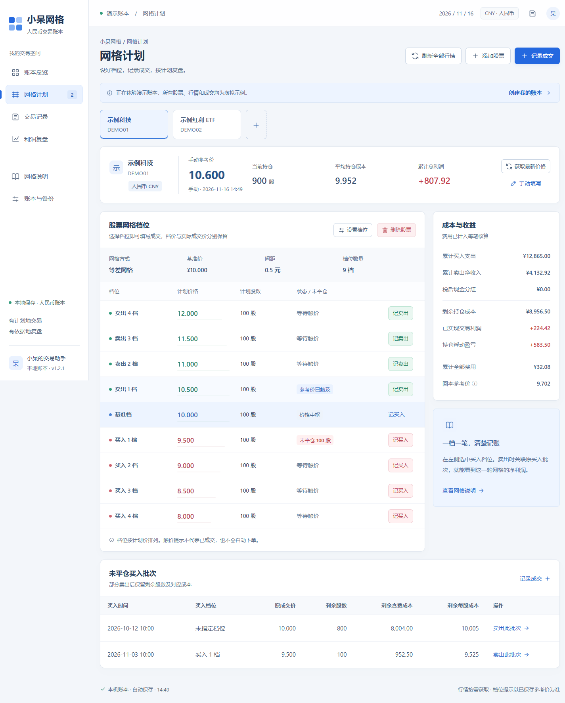

# 小呆网格

**人民币股票与 ETF 网格交易账本 · Windows 免安装 · 浅色交易工作台**

用一个本地账本规划买卖档位，记录实际成交，查看含费成本、已实现利润和持仓浮盈亏。

[下载 Windows 免安装版](https://github.com/CroTuyuzhe/xiaodai-stock-grid/releases/latest) · [详细使用说明](使用说明.md) · [虚拟示例账本](examples/demo-ledger.json) · [发布验证](验证记录.md)


## 下载与打开

1. 在 [Releases](https://github.com/CroTuyuzhe/xiaodai-stock-grid/releases) 下载 `XiaodaiGrid-v1.2.1-Windows-x64.zip`。
2. 将压缩包完整解压到一个文件夹，双击 `XiaodaiGrid.exe`。无需安装 Node.js，请保留同目录配套文件。
3. 初次打开显示**虚拟演示账本**。点击“创建我的账本”后，添加自己的证券代码、网格和实际成交。

适用于 Windows x64。校验文件 `SHA256SUMS.txt` 与程序在同一 Release 中提供。

## 可以做什么

| 功能 | 具体内容 |
| --- | --- |
| 网格计划 | 设定股票代码、基准价、等差或等比间距、档位数量和每档股数；支持逐档调整 |
| 成交记录 | 记录买入档位、实际成交价、股数、佣金、税费和其他费用 |
| 成本核算 | 每笔买入独立追踪；卖出可指定买入批次，也可使用先进先出；支持部分卖出 |
| 利润复盘 | 查看逐笔配对利润、累计交易利润、税后分红、持仓成本和总利润 |
| 手动行情 | 按代码获取证券名称和价格；手动刷新单只或全部证券；支持常见 A 股与人民币场内 ETF |
| 账本备份 | 本地自动保存、最近 30 个历史版本、完整 JSON 备份恢复、CSV 明细导入导出 |
| 股票删除 | 总览、网格页和设置窗口均提供入口；有历史记录时显示原因并可跳转查看 |
| 网格说明 | 软件内置公式、档位例子、期初持仓、分红、送转股和成本口径说明 |



正文和交易表格为 15 像素，辅助信息不小于 13 像素；采用浅色背景与清晰的金额展示。

## 免费行情怎么用

添加股票时可输入 `512480` 等代码，点击“按代码获取名称和价格”。每天打开软件后，按需点击“刷新全部行情”或“获取最新价格”。启动时不自动请求，也不定时轮询。

程序使用腾讯行情，失败时尝试新浪行情，无需填写 API Key。ETF 价格保留三位小数。界面分别显示行情时间和请求时间，较早的行情有明确标注；请求失败时保留原价格，也可以手动输入。

公开报价接口可能延迟、限流或调整，不能保证长期可用。软件只记录交易、计算利润和提供参考价，不连接券商或自动下单。

## 成本与总利润

- 买入含费成本 = 成交价 × 股数 + 买入佣金、税费和其他费用。
- 已实现交易利润 = 卖出净收入 − 对应卖出股数的买入含费成本。
- 总利润 = 已实现交易利润 + 税后分红 + 持仓浮动盈亏。

计算使用 Decimal.js 的十进制精度；原始价格与费用按字符串保存。费用按实际交割单填写，不自动假定佣金或税率。剩余批次的平均持仓成本可能与券商的摊薄成本口径不同。

## 示例与隐私

**本仓库、截图和免安装包仅包含虚拟示例，不包含作者的真实账本、成交记录、持仓、导出文件、备份或凭证。**

- `DEMO01`“示例科技”和 `DEMO02`“示例红利 ETF”为虚构证券，价格、日期、成交及分红均为演示数据；演示代码无法请求真实行情。
- `examples/demo-ledger.json` 来自软件内置的虚拟演示，可在“账本与备份”中导入；恢复账本会替换当前内容，操作前会显示预览并生成备份。
- 使用者自己的账本保存在本机 `%APPDATA%/小呆网格/data/`，软件不提供登录或云同步。
- 点击获取行情时，只向固定行情提供方发送证券代码；不上传成交、成本、利润或账本文件。
- 升级程序会继续读取本机已有账本。发布包中的演示数据只在没有已保存账本时显示。

## 从源码运行

需要 Node.js 和 npm，在项目目录执行：

```powershell
npm.cmd ci
npm.cmd start
```

```powershell
npm.cmd test
npm.cmd run test:ui
npm.cmd run test:delete-ui
npm.cmd run test:visual
npm.cmd run test:quotes-ui
npm.cmd run package
python scripts/archive.py
```

`test:quotes-ui` 会实际请求公开行情接口，需要联网；闭市、非交易日或数据缓存可能影响对“今日行情”的断言。其余桌面检查使用隔离的临时账本和缓存。

| 路径 | 内容 |
| --- | --- |
| `main.cjs` / `preload.cjs` | 桌面窗口、文件交互和受限通信 |
| `src/engine.js` | 网格、批次成本及利润计算 |
| `src/app.js` / `src/styles.css` | 中文浅色界面和虚拟演示 |
| `storage.cjs` | 本地账本保存与自动备份 |
| `market-quotes.cjs` | 用户主动触发的行情查询 |
| `tests/` / `scripts/` | 自动测试、桌面检查和打包 |

## v1.2.1

补充总览列表、网格页与股票设置底栏的删除入口；删除前显示确认。有成交、分红或送转记录时，说明保护原因并提供查看该股记录的入口。

当前项目未授予开源再分发许可（`UNLICENSED`）。随附第三方组件遵循各自许可，Decimal.js 许可见 `vendor/decimal-LICENCE.md`。
